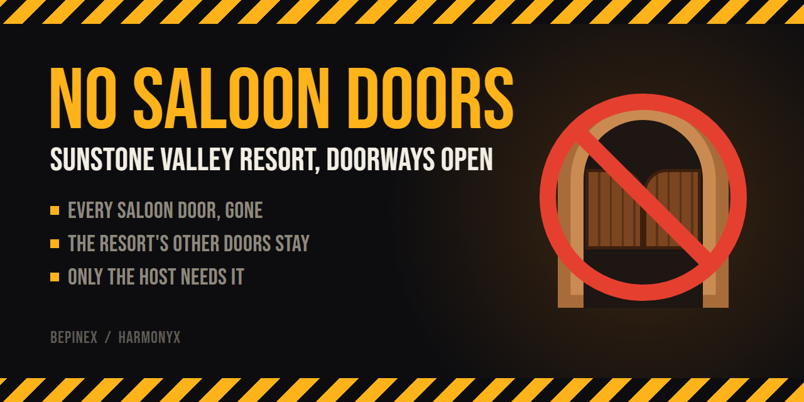

<p align="center">
  
</p>

<p align="center">
  <a href="https://github.com/RoryDotGG/NoSaloonDoors/blob/main/LICENSE"></a>
  
  
</p>

**NoSaloonDoors** takes the saloon doors out of Sunstone Valley Resort, the map added in R.E.P.O.'s Sunstone update. The doorways they sat in are left open, so nobody gets caught on swinging doors mid-chase or while carrying loot. The resort's other doors stay.

## Install

With a mod manager (r2modman, Gale), search for **NoSaloonDoors** in the Online tab and install it.

To install by hand, set up BepInEx, then put `NoSaloonDoors.dll` in `BepInEx/plugins/NoSaloonDoors/`.

Only the host needs the mod. The doors are never spawned, so they're gone for everyone in the lobby, whether or not they have it. If you join a lobby whose host doesn't have it, the doors are there.

## Config

`BepInEx/config/RoryDotGG.NoSaloonDoors.cfg`

| Key | Default | Notes |
| --- | --- | --- |
| `General.Enabled` | `true` | Applies from the next level. |
| `General.PrefabNames` | `Saloon Doors` | Comma-separated prefab names of the doorway props to leave out, in any case. Empty leaves every door. Applies from the next level. |

Any doorway prop a level places with `CustomConnectionObject` can go in `PrefabNames`. The mod is only meant for the saloon doors, so other names are untested.

## How it works

Sunstone Valley Resort (Desert in the game files) fills some doorways between rooms with a `CustomConnectionObject`, which spawns its door prefab in `Setup`. The saloon doors are `Level/Desert/Other/Saloon Doors`. The game only calls `Setup` on the host, or in singleplayer, where it spawns the door with `PhotonNetwork.InstantiateRoomObject`. So a Harmony prefix that skips `Setup` for the saloon doors leaves them out for every player.

The prefix also marks the doorway as filled. When both rooms have a connector at the same doorway, the second one checks the first and removes itself if the first has spawned. Without the mark, it would spawn its own copy of the door.

[GameLibs](https://www.nuget.org/packages/R.E.P.O.GameLibs.Steam) predates the Sunstone update, so `CustomConnectionObject` isn't in it. The patch finds the class by name at runtime, and logs a warning instead of patching on a game version without it.

| File | Purpose |
| --- | --- |
| [`src/Plugin.cs`](https://github.com/RoryDotGG/NoSaloonDoors/blob/main/src/Plugin.cs) | Config and start-up |
| [`src/SaloonDoorPatch.cs`](https://github.com/RoryDotGG/NoSaloonDoors/blob/main/src/SaloonDoorPatch.cs) | The `CustomConnectionObject.Setup` patch |
| [`src/DoorFilter.cs`](https://github.com/RoryDotGG/NoSaloonDoors/blob/main/src/DoorFilter.cs) | Pure name matching (no Unity), covered by `tests/DoorFilterCheck` |

## Build

You need the .NET SDK, version 8 or later.

```bash
dotnet build -c Release
```

To copy the DLL straight into a mod manager profile on build:

```bash
dotnet build -c Release -p:PluginsDir="$HOME/path/to/profile/BepInEx/plugins"
```

To build the Thunderstore package (`dist/NoSaloonDoors-<version>.zip`, ready to upload):

```bash
dotnet build -c Release -t:ThunderstorePackage
```

To release, bump `<Version>` in `NoSaloonDoors.csproj`, add a `CHANGELOG.md` entry, and merge it to `main`. That's the only place the version lives: the build writes it into the plugin, and the package build adds it to the zip's `manifest.json`. Then tag that commit and push the tag:

```bash
git tag v1.0.0
git push origin v1.0.0
```

The [release workflow](https://github.com/RoryDotGG/NoSaloonDoors/blob/main/.github/workflows/release.yml) checks the tag matches the version, runs the door-name check, builds the package, publishes it to Thunderstore and attaches the zip to a GitHub release. It needs a `THUNDERSTORE_TOKEN` repository secret holding a Thunderstore service account token for the team.

Run the door-name self-check (no game needed):

```bash
dotnet run --project tests/DoorFilterCheck
```

The [check workflow](https://github.com/RoryDotGG/NoSaloonDoors/blob/main/.github/workflows/check.yml) runs that check and builds the package on every pull request and every push to `main`. It doesn't publish anything.

The banner and icon are HTML in [`docs/mockups`](https://github.com/RoryDotGG/NoSaloonDoors/tree/main/docs/mockups). To re-render them, run this in PowerShell. It needs Brave, or pass `-Browser` with the path to any Chromium-based browser:

```powershell
./docs/mockups/render.ps1
```

## Compatibility

- Needs the Sunstone update (R.E.P.O. 0.5.0) or later. On an older game it does nothing and says so in the log.
- Other mods that patch `CustomConnectionObject.Setup` may clash with it.

## Licence

[MIT](https://github.com/RoryDotGG/NoSaloonDoors/blob/main/LICENSE)
